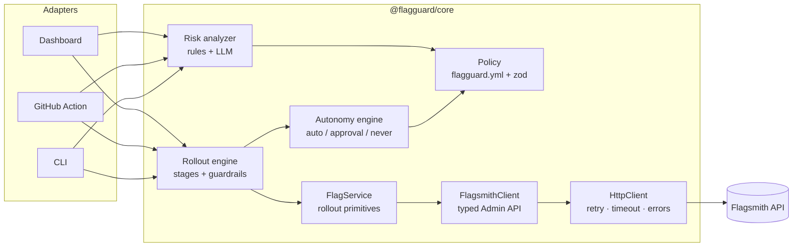

# Architecture

FlagGuard is a TypeScript monorepo. Business rules live in `@flagguard/core`, and the
delivery mechanisms (CLI, GitHub Action, dashboard) are thin adapters around it.



## Layers

| Layer             | Responsibility                                                                                        | Knows about                    |
| ----------------- | ----------------------------------------------------------------------------------------------------- | ------------------------------ |
| `HttpClient`      | Auth header, JSON, timeouts, retry with backoff (respecting `Retry-After`), typed `FlagsmithApiError` | HTTP only                      |
| `FlagsmithClient` | One method per Admin API endpoint, pagination                                                         | Flagsmith API shapes           |
| `FlagService`     | Rollout primitives: `ensureFeature`, `setRolloutPercentage`, `kill`                                   | How rollouts map onto segments |
| Autonomy engine   | Whether an action is `allow`, `needs_approval` or `deny`                                              | Policy                         |
| Policy            | Validated, defaulted config with safety invariants                                                    | Nothing else                   |

Each layer depends only on the layers below it, and every external dependency
(`fetch`, `sleep`, logger) is injected, so the whole stack runs against the
in-memory `FakeFlagsmith` in tests and offline demos.

## How a rollout maps onto Flagsmith

For each feature and environment:

```
environment default:  enabled = (percentage == 100)
segment override:     flagguard-rollout-<env>   (feature-specific segment)
                      rule: PERCENTAGE_SPLIT <percentage>
                      enabled = (percentage > 0)
```

- **Consistent cohorts.** Flagsmith hashes `identity + segment`, so raising the percentage
  only _adds_ users. Nobody flips back and forth.
- **Per-environment segments.** Staging can sit at 50% while Production is at 5%.
- **Non-destructive writes.** Overrides FlagGuard doesn't own are preserved, and the
  rollout override takes the lowest priority so explicit team overrides still win.
- **Kill switch.** Sets the environment default _and every override_ to disabled, so no
  path through the flag can serve new code.

> Percentage splits apply to **identified** users. Anonymous evaluations fall back to the
> environment default (off until 100%), which is the safe behaviour.

## Safety invariants (enforced in code)

1. Risk-increasing actions (`start_rollout`, `advance_rollout`, `complete_rollout`,
   `archive_flag`) cannot be `auto` without `autonomy.allowUnsafe: true`.
2. `kill_flag` can never be `never`.
3. Production environments can never be enabled outright. They only change through a
   staged rollout.
4. Non-idempotent `POST`s are never retried after a server error, which avoids duplicate
   flags or segments.

## Error handling

All intentional errors extend `FlagGuardError` and carry a stable `code`
(`CONFIG_INVALID`, `FLAGSMITH_API_ERROR`, `NOT_FOUND`). Configuration is validated
up front so problems surface as one readable message listing every issue.
