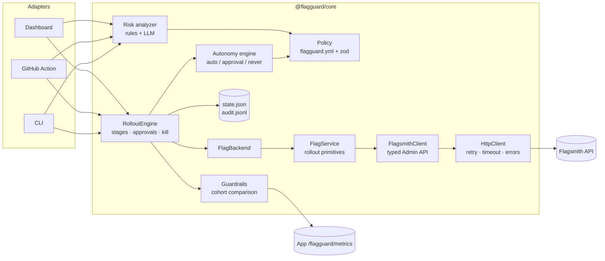
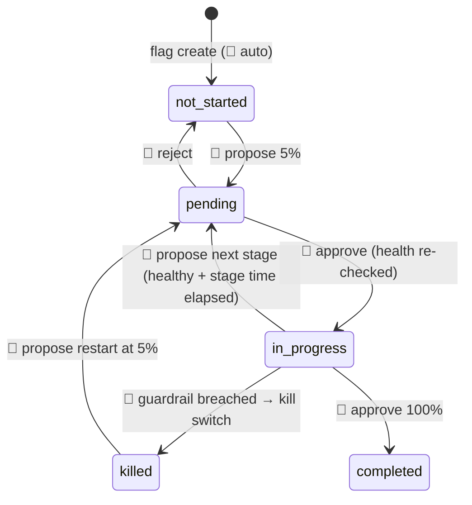

# Architecture

FlagGuard is a TypeScript monorepo. Business rules live in `@flagguard/core`, and the
delivery mechanisms (CLI, GitHub Action, dashboard) are thin adapters around it.



## Layers

| Layer             | Responsibility                                                                                        | Knows about                    |
| ----------------- | ----------------------------------------------------------------------------------------------------- | ------------------------------ |
| `HttpClient`      | Auth header, JSON, timeouts, retry with backoff (respecting `Retry-After`), typed `FlagsmithApiError` | HTTP only                      |
| `FlagsmithClient` | One method per Admin API endpoint, pagination                                                         | Flagsmith API shapes           |
| `FlagService`     | Rollout primitives: `ensureFeature`, `setRolloutPercentage`, `kill`                                   | How rollouts map onto segments |
| `FlagBackend`     | Name-addressed flag operations (`FlagsmithBackend`, or the demo shop when offline)                    | Flag & environment names       |
| `RolloutEngine`   | Next stage, gates, approvals, kill switch, audit trail                                                | Policy, backend, stores        |
| Guardrails        | Pure `evaluateHealth(snapshot, guardrails)` verdict                                                   | Metrics shapes                 |
| Autonomy engine   | Whether an action is `allow`, `needs_approval` or `deny`                                              | Policy                         |
| Policy            | Validated, defaulted config with safety invariants                                                    | Nothing else                   |

Each layer depends only on the layers below it, and every external dependency
(`fetch`, `sleep`, logger) is injected, so the whole stack runs against the
in-memory `FakeFlagsmith` in tests and offline demos.

## The agent loop



Every transition goes through `decide(policy, action)`, which returns `allow`, `needs_approval`
or `deny`. A human running a command directly (`advance`, `kill`) _is_ the approval for that
command. The agent's own requests (`propose`, `watch`) wait for one whenever the action
increases exposure.

**Gates before any stage increase** (in order):

1. **Health:** never advance an unhealthy rollout. `--force` can't override this.
2. **Data:** at least `minSamples` requests on the new code.
3. **Time:** the current stage has run for `minStageMinutes`.

**State.** Flagsmith is the source of truth for what users get. `.flagguard/state.json`
records how we got there: stage start time, pending approval and last health verdict. If
someone changes the percentage in the Flagsmith dashboard, FlagGuard detects the drift and
adopts the live value. Writes are atomic (temp file and rename).

**Audit log.** `.flagguard/audit.jsonl` is append-only JSON Lines. Every applied, pending,
blocked, denied or failed action is recorded with its actor (`agent` or `human:<name>`), a
plain-language reason and the health numbers behind it. Health checks are logged only when
the verdict changes, so the log stays readable.

## How a rollout maps onto Flagsmith

For each feature and environment:

```
environment default:  enabled = (percentage == 100)
segment override:     flagguard-rollout-<env>   (feature-specific segment)
                      rule: PERCENTAGE_SPLIT <percentage>
                      enabled = (percentage > 0)
```

- **Consistent cohorts.** Flagsmith hashes `identity + segment`, so raising the percentage
  only _adds_ users. Nobody flips back and forth.
- **Per-environment segments.** Staging can sit at 50% while Production is at 5%.
- **Non-destructive writes.** Overrides FlagGuard doesn't own are preserved, and the
  rollout override takes the lowest priority so explicit team overrides still win.
- **Kill switch.** Sets the environment default _and every override_ to disabled, so no
  path through the flag can serve new code.

> Percentage splits apply to **identified** users. Anonymous evaluations fall back to the
> environment default (off until 100%), which is the safe behaviour.

## Health signal: cohort metrics

Apps report request outcomes per **cohort**: `treatment` (flag on, new code) and
`control` (flag off, old code). They expose a sliding-window snapshot at
`GET /flagguard/metrics/:flag`:

```json
{
  "flag": "fg_new_checkout",
  "windowMs": 120000,
  "generatedAt": "2026-11-27T13:45:00.000Z",
  "treatment": {
    "requests": 108,
    "errors": 17,
    "errorRate": 0.157,
    "p50LatencyMs": 61,
    "p95LatencyMs": 312
  },
  "control": {
    "requests": 231,
    "errors": 0,
    "errorRate": 0,
    "p50LatencyMs": 91,
    "p95LatencyMs": 108
  }
}
```

Comparing cohorts over the _same_ window separates "the new code is broken" from
"everything is slow right now", so the kill switch doesn't fire on platform-wide
incidents the flag can't fix. `SlidingWindowMetrics` in `@flagguard/core` implements the
recorder, and the demo shop shows how to wire it into a request handler.

## Safety invariants (enforced in code)

1. Risk-increasing actions (`start_rollout`, `advance_rollout`, `complete_rollout`,
   `archive_flag`) cannot be `auto` without `autonomy.allowUnsafe: true`.
2. `kill_flag` can never be `never`.
3. Production environments can never be enabled outright. They only change through a
   staged rollout.
4. Non-idempotent `POST`s are never retried after a server error, which avoids duplicate
   flags or segments.
5. Approving a stage increase re-checks health first. An approval granted before a
   regression can't push more users onto broken code.

## Flagsmith API notes (verified against the live API)

- `PERCENTAGE_SPLIT` conditions must send `"property": null`. Omitting it causes a 500, and an
  empty string causes a 400.
- The unified flag-state endpoint returns `variants: []` on overrides but rejects that field
  on write for standard (non-multivariate) flags, so FlagGuard only echoes non-empty variants.
- Both behaviours are mirrored by `FakeFlagsmith`, so regressions fail in unit tests.

## Error handling

All intentional errors extend `FlagGuardError` and carry a stable `code`
(`CONFIG_INVALID`, `FLAGSMITH_API_ERROR`, `NOT_FOUND`). Configuration is validated
up front so problems surface as one readable message listing every issue.
